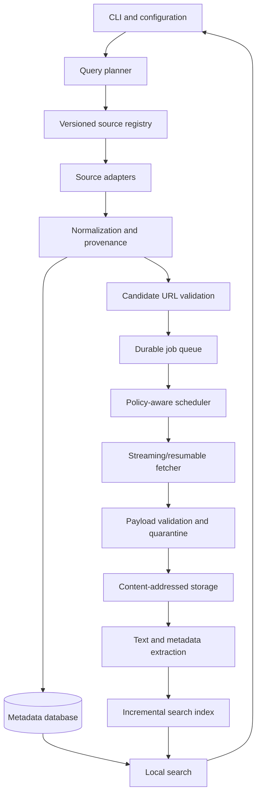

# PaperEngine

A high-performance, fault-tolerant Rust engine for discovering scholarly papers, validating lawful full-text candidates, acquiring authorized files, and maintaining a durable, searchable local research library.

## Project status

**Planning/bootstrap stage.** This repository begins with requirements, architecture constraints, and a phased issue backlog. It is not yet an implemented downloader or search engine. Performance claims must be backed by repeatable benchmarks.

## Core principles

- Rust-first, local-first, single-user by default.
- Fast through bounded concurrency, streaming I/O, incremental work, caching, and avoiding redundant requests—not by bypassing source restrictions.
- Durable jobs and resumable operations; recover cleanly after process or machine failure.
- Separate scholarly works, manifestations/versions, source records, candidate URLs, stored objects, and provenance.
- Preserve raw metadata and explain normalization or conflict decisions.
- Prefer official APIs, repository exports, OAI-PMH, and explicitly permitted bulk datasets.
- Respect source terms, documented quotas, rate limits, authentication requirements, and access controls. CAPTCHA, 403, 429, login restrictions, or prohibited automation are restriction signals—not challenges to bypass.
- Discovery-only mode must never download payloads.
- No unverified claims about source coverage, capacity, speed, or success rates.

## Architecture



## Initial module boundaries

- `config`: typed configuration, validation, resource budgets, secret redaction.
- `domain`: work, manifestation, source, candidate, object, job, provenance types.
- `planner`: query decomposition, source priorities, budgets, dry-run plans.
- `sources`: versioned plugin contract and source adapters.
- `discovery`: metadata ingestion, pagination, identifier expansion, paper classification.
- `validation`: URL safety, bounded redirects, cached link-health checks, MIME/status classification.
- `queue`: durable state machine, leases, heartbeats, retries, crash recovery.
- `scheduler`: per-source quotas, backpressure, fairness, circuit breakers.
- `fetch`: streaming downloads, range resume where supported, checksums and size limits.
- `storage`: content-addressed objects, atomic finalization, volume watermarks, backups.
- `extract`: PDF/XML/text validation and provenance-aware extraction.
- `index`: incremental metadata and full-text indexing.
- `cli`: search, collection management, progress, dry-run, diagnostics, health checks.
- `observability`: structured logs, metrics, benchmark and diagnostic output.

Keep boundaries narrow and avoid duplicated business logic. Prefer one canonical implementation per behavior.

## Reliability model

Jobs use explicit persisted states, bounded retries, typed error categories, timestamps, and recovery rules. A retry is not a bypass. Authentication restrictions, CAPTCHAs, prohibited automation, and policy blocks must be recorded and routed to a documented authorized alternative or terminal state.

Downloads stream to temporary files, enforce resource limits, verify expected size/checksum where available, validate payload type, and atomically finalize into content-addressed storage. Invalid or suspicious payloads are quarantined instead of being silently indexed.

## Performance requirements

- Measure throughput, latency, memory, disk amplification, DB write cost, cache hit rate, retry rate, and recovery time.
- Establish a representative permitted corpus and benchmark environment before setting targets.
- Use bounded parallelism and per-source rate policies; global concurrency must never override source limits.
- Avoid unbounded buffering; stream large responses and extraction inputs.
- Deduplicate before network work and use conditional revalidation when supported.
- Keep performance regression budgets reproducible; do not optimize by weakening correctness or policy enforcement.

## Phased roadmap

- **P0 — Foundation:** freeze scope, capacity model, architecture decisions, validated config, data model, durable state machine.
- **P1 — Discovery:** plugin contract, normalization, query planner, paper-only rules, official metadata/repository adapters.
- **P2 — Validation and policy:** URL canonicalization, tiered link checks, restriction handling, cache TTL.
- **P3 — Scheduling:** durable queue, leases, retries, backpressure and adaptive scheduling.
- **P4 — Acquisition and storage:** streaming/resumable downloads, PDF validation, content-addressed storage, multi-volume safety.
- **P5 — Library experience:** extraction, indexing, CLI search and collection workflows.
- **P6 — Hardening:** diagnostics, fault injection, load tests and benchmark gates.
- **P7 — Optional extensions:** reviewed bulk-ingestion paths, external-storage workflows, multi-worker coordination and read-only HTTP search.

## Build and verification

The implementation is expected to use stable Rust, automated formatting, linting, unit/integration tests, fault-injection tests, and reproducible benchmarks. Once the Rust workspace exists, the baseline checks should include:

```bash
cargo fmt --all -- --check
cargo clippy --workspace --all-targets --all-features -- -D warnings
cargo test --workspace --all-features
```

These commands are roadmap expectations until the workspace is implemented; they are not currently passing project checks.

## Issue workflow

Work in small, reviewable slices. Resolve P0 design and scope questions before implementing later phases. Do not attempt to solve the entire backlog in one change. Each issue should define tests, acceptance criteria, failure behavior, and documentation updates. Keep the default branch `main`; avoid parallel feature branches unless explicitly requested.

See [Requirements](docs/REQUIREMENTS.md), [Traceability](docs/TRACEABILITY.md), and the GitHub Issues backlog.
